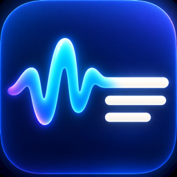

<p align="center">
  
</p>

<h1 align="center">Live Transcribe</h1>

<p align="center">English captions for the audio playing on your Mac.<br>Native macOS app. On-device speech recognition. Copy the words you need.</p>

<p align="center">
  <a href="https://github.com/sergiishpak/live-transcribe/releases/latest"><strong>Download for Apple Silicon</strong></a>
  &nbsp;·&nbsp;
  <a href="#getting-started">Getting started</a>
  &nbsp;·&nbsp;
  <a href="#build-from-source">Build from source</a>
</p>

Live Transcribe listens to your Mac’s system audio and turns speech into selectable text while it plays. Use it alongside a video, podcast, or call, then copy a sentence with one click. Your microphone is not captured, so your own voice in a call is not included unless it is also playing through system audio.

This is a personal tool shared publicly. Bug reports and focused contributions are welcome; support and release schedules are best effort.

## Getting started

**Apple Silicon Mac · English speech · macOS 14.2 or later declared minimum.** Older macOS versions and other Mac configurations have not all been tested; see [compatibility and limitations](docs/INSTALL.md#compatibility).

1. Download the Apple Silicon `.dmg` from [Releases](https://github.com/sergiishpak/live-transcribe/releases/latest), open it, and drag **Live Transcribe** into **Applications**.
2. Open the installed app. The initial release is ad-hoc signed and **not notarized**. If macOS blocks it, follow the [opening instructions](docs/INSTALL.md#opening-the-initial-release).
3. Wait for **Preparing model…** to change to **Ready**. First launch needs internet access to download the speech model; a previous check downloaded about **600 MB**. Preparation can take several minutes.
4. Click **Start** and allow macOS’s system-audio recording permission when prompted. Play some English speech on your Mac.
5. Copy a sentence using its copy button, or select text within a sentence and press **⌘C**. Click **Stop** when finished.

If something fails, start with the [installation and troubleshooting guide](docs/INSTALL.md).

## A small window for live text

- **Start / Stop** — begin or end capture. Stopping keeps the text in the window; starting again appends to it.
- **Clear** — remove the current transcript.
- **Always on Top** — keep the window visible above other apps.
- **Jump to Live** — resume following new text after scrolling away.
- **Skip to Live** — when transcription falls behind, discard pending audio and insert a marker showing the skipped interval.

The latest words may change as recognition catches up. Accuracy and delay depend on the audio and your Mac. There is no speaker labeling, translation, file import, or saved transcript history.

## Privacy and the model

Speech recognition runs locally with [FluidAudio](https://github.com/FluidInference/FluidAudio) and the [Parakeet Unified 0.6B CoreML model](https://huggingface.co/FluidInference/parakeet-unified-en-0.6b-coreml). The app does not send audio or transcripts to a transcription service and has no account or API key requirement.

The model is downloaded from Hugging Face and cached under `~/Library/Application Support/FluidAudio/Models/`. Once the required files are cached, transcription can work offline. A missing or damaged model cache may trigger another download. Initial downloads make normal network requests to the model host.

The app has no audio recording or transcript autosave feature. The transcript stays in memory until you clear it or quit; copied text goes to the macOS clipboard. Window placement and the Always on Top preference persist between launches. See [third-party notices](THIRD_PARTY_NOTICES.md) for model attribution and licenses.

## Build from source

Use an Apple Silicon Mac with **Swift 6.0 or later**, **Python 3**, and Apple’s Command Line Tools or Xcode. Build tools and dependency downloads need internet access. The model is downloaded when the app runs, not during the build.

```sh
git clone https://github.com/sergiishpak/live-transcribe.git
cd live-transcribe
./scripts/build-app.sh
open "dist/Live Transcribe.app"
```

To build, replace `/Applications/Live Transcribe.app`, and launch it:

```sh
./scripts/build-and-install.sh
```

That command quits a running copy before replacing it. Copy any transcript you want to keep first.

```sh
swift test                 # state and transcript tests; no audio permission or model download
./scripts/build-dmg.sh     # release app, DMG, and SHA-256 checksum in dist/
```

Release numbers follow [semantic versioning](docs/RELEASING.md#semantic-versioning). `VERSION` drives the app version and the `Live-Transcribe-<version>-arm64.dmg` filename; use `./scripts/version.py patch`, `minor`, or `major` when preparing a release.

[Developer guide](docs/DEVELOPMENT.md) · [Release guide](docs/RELEASING.md) · [Changelog](CHANGELOG.md) · [Contributing](CONTRIBUTING.md)

## License

Live Transcribe’s own code is available under the [MIT license](LICENSE). Dependencies and the downloaded speech model retain their own licenses; their credits and license texts are listed in [third-party notices](THIRD_PARTY_NOTICES.md).
