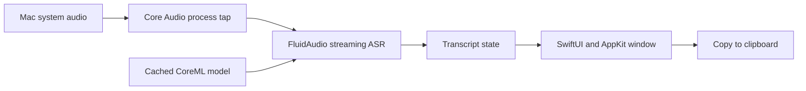

# Development

Live Transcribe is a small Swift Package executable, packaged as a native `.app` by shell scripts. There is no Xcode project to generate, backend to run, or API key to configure.

## Prerequisites

- Apple Silicon Mac; the distribution scripts build arm64 only.
- macOS 14.2 or later as the declared deployment target; see [tested compatibility](INSTALL.md#compatibility).
- Swift 6.0+ from Apple Command Line Tools (`xcode-select --install`) or Xcode. Check with `swift --version` and `xcode-select -p`.
- Python 3 for release-version validation and bumping.
- Internet for Swift Package Manager dependencies; first app launch separately downloads the speech model.

Open `Package.swift` in Xcode if you prefer an editor UI. Run the packaged app to exercise its Info.plist permission declaration; `swift run` is not the supported installation path.

## Everyday commands

```sh
swift test
./scripts/build-app.sh
open "dist/Live Transcribe.app"
```

`build-app.sh` resolves the pinned dependencies from `Package.resolved`, builds a release executable, packages the icon and notices, embeds `VERSION`, and ad-hoc signs the bundle by default. It does not install or launch anything. Keep `VERSION` in `major.minor.patch` form.

Use `./scripts/version.py patch` (or `minor` / `major`) to update the release version and move the Unreleased changelog notes into a dated entry. Add `--dry-run` to preview. See [semantic versioning](RELEASING.md#semantic-versioning) for the policy. Packaging reads the same validated version for the app, DMG, and checksum filenames.

```sh
./scripts/build-and-install.sh
```

This additionally quits a running copy, replaces `/Applications/Live Transcribe.app`, and opens the installed copy. Copy any needed transcript first. Repository instructions require running this after app changes.

## Layout

```text
Sources/LiveTranscribe/       App and its small state types
Tests/LiveTranscribeTests/    Transcript, lifecycle, and backlog tests
Resources/                   Info.plist and icon sources
scripts/                     Build, install, DMG, and package verification
licenses/                    Third-party license texts
docs/                        User, developer, and release documentation
docs/archive/                Historical plans; not current specifications
dist/                        Generated app, DMG, and checksums (ignored)
```

## How audio becomes text



| File | Responsibility |
| --- | --- |
| `App.swift` / `MainView.swift` | App entry point, controls, and window preferences. |
| `AppModel.swift` | Preparation, capture lifecycle, and UI-facing state. |
| `SystemAudioCapture.swift` | Private Core Audio tap, aggregate device, and buffer delivery. |
| `StreamingTranscriber.swift` | FluidAudio model preparation, streaming updates, and backlog. |
| `Transcript.swift` | Committed/provisional text and sentence splitting. |
| `TranscriptTextView.swift` | Selectable sentence rows, copy buttons, and live scrolling. |

The selected engine is **Parakeet Unified 0.6B** using `[70, 2, 2]` context (a 320 ms model configuration). That configuration is not an end-to-end latency guarantee. FluidAudio handles model files and audio conversion. No microphone capture, audio file storage, transcript database, or cloud transcription is implemented.

FluidAudio also declares resources for its unrelated text-to-speech features. This app uses only its ASR path, which does not access those resources, so the app builder deliberately does not ship the TTS resource bundle. Recheck that decision if introducing TTS or a different engine.

## Verification

`swift test` uses Swift Testing to exercise transcript/state behavior without starting model preparation or audio capture. The tests use the framework bundled with Swift 6, so a separate XCTest installation is not required. GitHub Actions runs tests, builds the app, creates a DMG, and checks the package. It does not publish a release or exercise permission prompts and speech recognition.

Run `python3 -m unittest discover -s scripts/tests` for version bump/reset rules, malformed-version rejection, changelog preservation, and dry-run behavior. CI runs these tests alongside the Swift suite.

Before a public release, also test the installed app with controlled English system audio, copying, Stop/Start, Clear, and scrolling. See [the release checklist](RELEASING.md). Keep synthetic-audio checks distinct from real-call accuracy and latency measurements.

`Package.resolved` is committed. When changing dependencies, review their model/runtime behavior and update [third-party notices](../THIRD_PARTY_NOTICES.md), including notices shipped inside the app.
